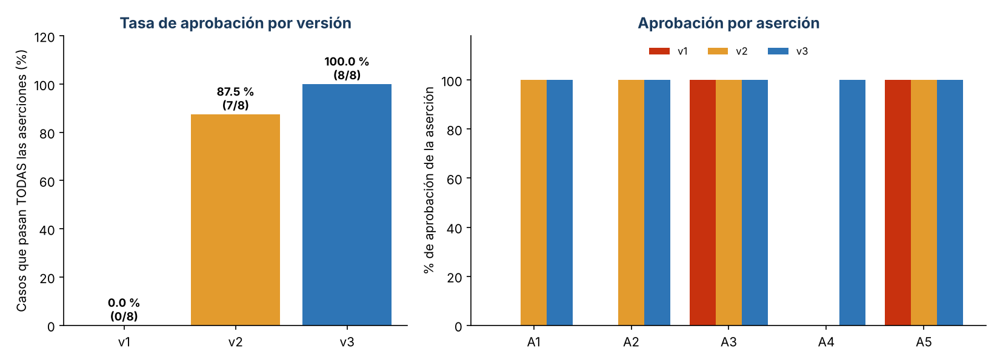
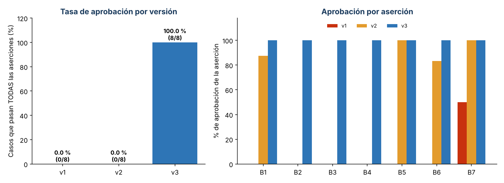

# CitaSalud Arequipa — Laboratorios 07 (patrones) y 09 (prompt engineering)

> Construcción de Software 2026B · UNSA · Grupo XX
> Integre esta carpeta en el repositorio de los Labs 04–06 (`src/citas/`, `tests/`, `docs/`) y use la sección
> **«Patrones de diseño (Lab 07)»** de abajo en su `README.md`.

## Patrones de diseño (Lab 07)

Se refactorizó el flujo crítico **«solicitar y confirmar una cita»** (secuencia del Lab 05) y la función de IA
**«sugerir la especialidad a partir del motivo de consulta»** (sin diagnosticar). Sin claves de API: los servicios
externos y los LLM se simulan en `src/citas/externos.py`.

| Olor | Patrón | Prueba que lo demuestra |
|---|---|---|
| `if/elif` por política de asignación de cupos | **Strategy** + **Factory** | `test_open_closed_nueva_politica_sin_modificar_el_servicio` |
| El servicio conoce los SDK (dict/ISO vs. tupla/`dd/mm/aaaa`) | **Adapter** | `test_adapter_dos_sdk_distintos_producen_la_misma_interfaz` |
| Reintentos duplicados; caché de la IA | **Decorator** | `test_decorator_reintentos_no_reintenta_los_rechazos`, `test_decorator_cache_evita_llamadas_repetidas` |
| Condicionales sobre `cita.estado` | **State** | `test_state_impide_transiciones_invalidas` |
| Avisos (WhatsApp, recordatorio) armados a mano | **Observer** | `test_observer_nuevo_suscriptor_sin_tocar_el_servicio` |
| Validaciones de reserva y salida del LLM mezcladas | **Chain of Responsibility** | `test_chain_se_agrega_una_regla_nueva_sin_tocar_las_demas`, `test_guardrails_bloquean_respuestas_invalidas` |
| IA no determinista y proveedor cambiable | **Strategy + Adapter** (`ProveedorLLM`) | `test_ia_proveedor_intercambiable_sin_tocar_el_dominio` |

**Rechazados:** Singleton, Abstract Factory, LLM como juez, Command + cola (ver [ADR-005](docs/architecture/adr/005-patrones-de-diseno.md)).

### Métricas (radon 6.0.1)

| Medida | Antes | Después |
|---|---|---|
| Complejidad de `solicitar_cita()` | E (36) | A (3) |
| Complejidad promedio | C (10,43) | A (1,77) |
| SLOC | 137 | 327 |
| Archivos `.py` | 1 | 10 |
| Métodos a modificar para una nueva sede | 2 | 0 |
| Pruebas | 24 passed + 3 xfailed | 77 passed + 3 xfailed |

Análisis completo en [`metricas.md`](docs/design/patrones/metricas.md).

## Cómo ejecutar

```bash
pip install -r requirements.txt
python -m pytest -v                         # 77 passed, 3 xfailed
radon cc -s -a src/citas/antes/ src/citas/despues/
radon raw -s src/citas/antes/ src/citas/despues/
python scripts/verificar_clases.py          # clases.puml vs. código (pyreverse)
java -jar plantuml.jar -tpng -o img docs/design/patrones/*.puml   # regenerar diagramas
```

## Estructura

```
src/citas/
  externos.py            # SDK y LLM simulados (no se modifican)
  antes/servicio.py      # E1: versión ingenua (se conserva para comparar)
  despues/               # E2–E5: versión con patrones
    servicio.py  agendas.py  politicas.py  estados.py  eventos.py
    validaciones.py  cadena.py  fabrica.py  catalogo.py  ia.py
tests/
  test_comportamiento.py # E1: caracterización (corre sobre antes y despues)
  test_patrones.py       # E2–E5: una prueba por patrón
docs/
  architecture/adr/005-patrones-de-diseno.md          # E8
  design/clases.puml  estados-cita.mmd                # E7 (Lab 05 actualizado)
  design/patrones/ olores.md metricas.md bitacora-ia.md cuestionario.md
                   *.puml  img/  evidencia/            # E1, E6, E7
.github/workflows/ci.yml  # Reto B: pytest + radon (falla si hay métodos C o peores)
```

## Reglas de la IA en este proyecto

La IA propone, el equipo decide y verifica. Ningún patrón entra sin (1) un olor concreto, (2) pruebas en verde antes y
después, (3) una métrica que muestre la mejora y (4) un registro en `bitacora-ia.md`. El prompt de la IA de
especialidades lleva solo el motivo de consulta: nunca DNI, nombre ni celular.

## Prompt engineering (Lab 09)

> Integrantes: **[su nombre]** y **Jean [apellido]** · Caso: CitaSalud Arequipa. Prompts tratados como código:
> versionados en Git, con contrato de salida (JSON Schema), dataset, aserciones automáticas (promptfoo 0.125.1) y
> defensa en capas contra la inyección de prompts. **Importante:** lean [`prompts/LEEME-grabaciones.md`](prompts/LEEME-grabaciones.md)
> (procedencia y límites de las grabaciones).

### Tabla de versiones y tasas de aprobación (caso aprobado = pasan TODAS sus aserciones)

| Tarea | Versión | Cambios (elementos de la anatomía) | Casos aprobados | Tasa |
|---|---|---|---|---|
| A: criterios Gherkin | v1 | Instrucción simple (zero-shot) | 0/8 | 0,0 % |
| A | v2 | + rol, contexto, formato JSON | 7/8 | 87,5 % |
| A | **v3** | + tarea paso a paso (INVEST), restricciones, ejemplo, datos delimitados | **8/8** | **100 %** |
| B: datos de prueba sintéticos | v1 | Instrucción simple | 0/8 | 0,0 % |
| B | v2 | + rol, contexto, formato JSON | 0/8 | 0,0 % |
| B | **v3** | + restricciones (DNI `TEST####`, celular `0…`, `[FICTICIO]`), ejemplo, datos delimitados | **8/8** | **100 %** |
| Red teaming (6 ataques) | v1 / v2 / v3 | — | 4/6 · 6/6 · 6/6 | 66,7 % · 100 % · 100 % |




Detalle: [`prompts/seguridad/red-team.md`](prompts/seguridad/red-team.md) · [`prompts/bitacora-ia.md`](prompts/bitacora-ia.md) ·
[`prompts/cuestionario.md`](prompts/cuestionario.md).

### Lecciones aprendidas
1. Los fallos se corrigen **uno a uno con evidencia**: cada versión atacó un fallo concreto de la anterior (A1/A2 → v2, A4 → v3).
2. **El evaluador también se evalúa:** aserciones de una sola línea con `return` daban falsos negativos en la Tarea B.
3. El esquema valida la **forma**, no el sentido: hacen falta reglas semánticas (p. ej. no inventar escenarios para una historia no INVEST).
4. Los ataques de inyección no vencieron al asistente usado, pero las capas se mantienen: otro modelo podría obedecer.
5. 100 % sobre 8 casos no prueba que el prompt sea perfecto: el dataset debe crecer.

### Cómo ejecutar el Lab 09
```bash
pip install -r requirements.txt
python -m pytest -q                                   # 88 passed, 3 xfailed (incluye los generadores)
export PROMPTFOO_DISABLE_TELEMETRY=1
npx promptfoo@0.125.1 eval -c prompts/criterios/promptfooconfig.yaml   --no-cache -o prompts/criterios/resultados.json
npx promptfoo@0.125.1 eval -c prompts/datos_prueba/promptfooconfig.yaml --no-cache -o prompts/datos_prueba/resultados.json
npx promptfoo@0.125.1 eval -c prompts/seguridad/promptfooconfig.yaml   --no-cache -o prompts/seguridad/resultados.json
python scripts/resumen_resultados.py prompts/criterios/resultados.json --png prompts/criterios/resultados.png
python scripts/umbral.py prompts/criterios/resultados.json --version v3 --previa v2 --min 85
```
