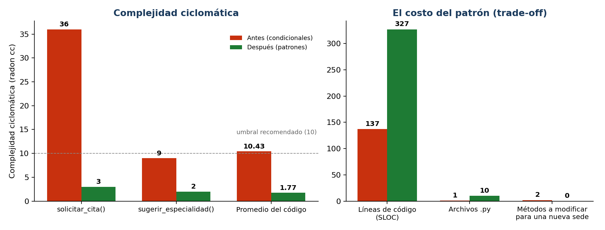

# Métricas y trade-off (E6) — CitaSalud Arequipa

Herramientas: `radon 6.0.1`, `pytest 9.1.1`, Python 3.12. Salidas completas en `evidencia/`.



## Complejidad ciclomática (`radon cc -s -a`)

| Método / medida | Antes | Después |
|---|---|---|
| `solicitar_cita()` | **E (36)** | **A (3)** |
| `sugerir_especialidad()` | B (9) | A (2) en `GeneradorSugerencias` (1 en el servicio) |
| Mayor complejidad de cualquier método | 36 | 5 (`ServicioCitas.__init__`) |
| **Promedio** (bloques: clases + métodos) | **C (10,43)** sobre 7 bloques | **A (1,77)** sobre 118 bloques |

## Tamaño y mantenibilidad

| Medida | Antes | Después |
|---|---|---|
| Líneas de código (SLOC, `radon raw`) | 137 | 327 |
| Archivos `.py` (sin `__init__`) | 1 | 10 |
| Índice de mantenibilidad (`radon mi`) | A (35,8) | A (51,4 a 100 según archivo) |
| Métodos a modificar para una **nueva sede** | 2 (`solicitar_cita` en 2 bloques `if/elif` + `__init__`) | **0** (`fabrica.registrar(...)`) |
| Métodos a modificar para una **nueva política** | 1 (`solicitar_cita`) | **0** |
| Pruebas | 24 passed + 3 xfailed (solo antes) | **77 passed, 3 xfailed** (suite completa) |

## Análisis del trade-off (5 a 8 líneas)

**Qué ganamos:** el método principal pasó de complejidad 36 a 3 y el promedio de 10,43 a 1,77; nueva sede,
nueva política de cupos, nuevo canal de aviso o nuevo proveedor de IA se agregan *sin tocar* el servicio
(probado con `test_open_closed_*`, `test_observer_*`). La IA queda aislada y probable sin red ni clave de API.
**Qué costó:** el código creció de 137 a 327 SLOC (x2,4) y de 1 a 10 archivos; quien mantenga el módulo debe conocer
los patrones y seguir un flujo entre varias clases. **Cuándo la versión antes habría bastado:** si CitaSalud tuviera
una sola sede, una sola política de asignación y no usara IA, el único problema real habría sido el bug del estado,
corregible con 3 líneas. Los patrones se justifican por los **cambios previstos** (más sedes y especialidades),
no por sí mismos. Veredicto: *valió la pena* porque el roadmap incluye sedes nuevas y el flujo de IA exige guardrails.

## Patrones que decidimos NO aplicar

| Patrón | Por qué no |
|---|---|
| **Singleton** (para `FabricaAgendas`) | Introduce estado global: dos pruebas compartirían SDK simulados y fallarían de forma intermitente. Se inyecta la dependencia. |
| **Abstract Factory** (familias de sedes) | No hay familias de productos relacionados; sería una jerarquía paralela solo para 2 sedes. |
| **Command + cola** para la reserva | Útil para modo offline (Lab 05 no lo exige para este flujo); se pospone hasta que el requisito exista. |
| **LLM como juez** de guardrails | Costo/latencia extra; las reglas deterministas bastan y son probables. |

## Reproducir

```bash
pip install -r requirements.txt
python -m pytest -v
radon cc -s -a src/citas/antes/ ; radon cc -s -a src/citas/despues/
radon raw -s src/citas/antes/ src/citas/despues/ ; radon mi -s src/citas/antes/ src/citas/despues/
python scripts/verificar_clases.py        # pyreverse vs. docs/design/clases.puml
```
